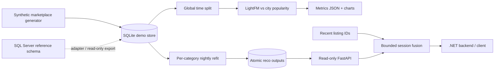
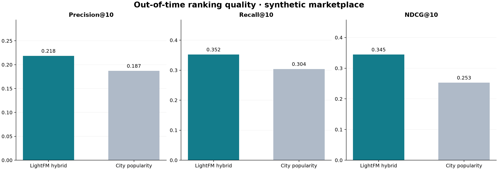
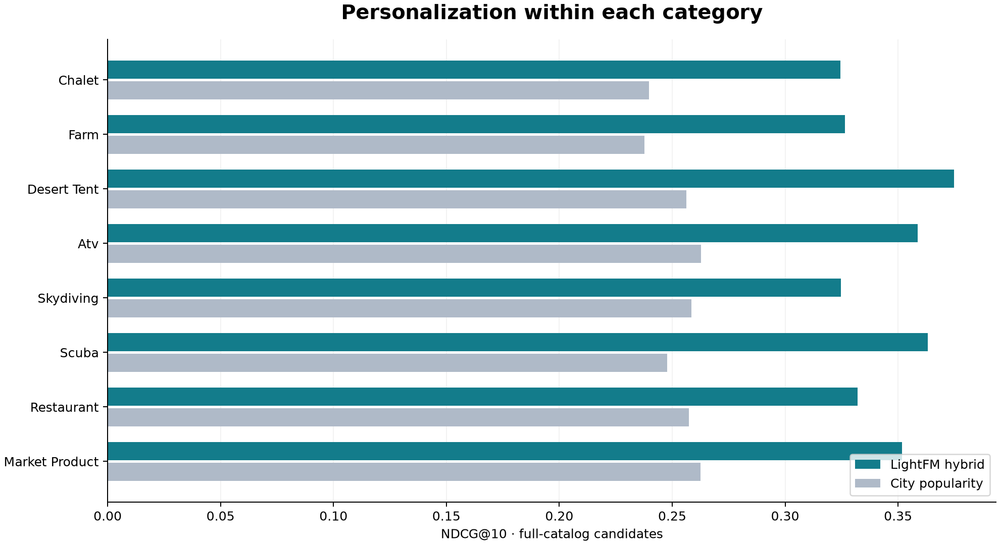

<div align="center">

# Experience Booking Recommender

**Discovery that respects the category — and adapts to the session.**

Python 3.11 · LightFM hybrid · FastAPI · SQLAlchemy · SQL Server reference · .NET integration

[Quick start](#quick-start) · [Measured results](#measured-results) · [API](#api) · [Design](#design-decisions) · [SQL Server](docs/sql-server.md)

</div>

An independent portfolio project by **Sarah Matar**. Every user, listing, vendor,
search, and interaction is synthetic. No private code, customer data, or external
business branding is included.

## The problem

A marketplace can sell very different experiences: a family chalet, an ATV tour,
a restaurant meal, or an artisan gift. A single global popularity feed ignores
both user taste and intent. Recommendations should answer **“what fits this user
within the category they are browsing?”**, without putting model training on the
request path.

This project delivers the complete loop: synthetic data → temporal evaluation →
nightly hybrid training → transactional batch publication → a read-only API with
session-aware reranking. It is a runnable engineering demonstration, not a claim
of commercial recommendation performance.

## What is included

- **Eight category models:** chalet, farm, desert tent, ATV, skydiving, scuba,
  restaurant, and market product.
- **A realistic synthetic catalog:** 360 users, 800 listings, five Gulf-region
  cities, content tags, per-category price buckets, and latent preferences.
- **LightFM WARP hybrid:** user identity plus training-only preference features;
  item metadata without item identity embeddings, allowing shared-feature cold items.
- **Guest/cold-user fallback:** weighted popularity by category and city, with
  category-wide backfill.
- **Nightly CLI:** evaluate first, refit on all observations, publish all categories
  atomically, and append model audit records.
- **FastAPI:** recommendations, similarity, popularity, readiness, OpenAPI docs.
- **Delivery:** 30 pytest tests, lint checks, Docker/Compose, CI configuration,
  an MIT license, and a typed C# `HttpClient` example.

## Architecture



Online requests never import a serialized model or run training. They query
precomputed candidates, enforce catalog eligibility, and blend in learned
item-to-item similarity. SQLAlchemy maps the `dbo`/`reco` namespaces into SQLite's
main namespace for the local demo.

## Quick start

**Requirements:** Linux/macOS, `uv`, and a C compiler (`gcc` on Linux). `make` is optional.
Python 3.11 is provisioned by `uv`; LightFM's legacy native build is pinned.
On Debian/Ubuntu, the build packages are `build-essential` and the runtime needs
`libgomp1`. On macOS, use the Xcode command-line tools. The local CLI uses a POSIX
file lock; on Windows, use WSL2 or Docker.

```bash
./scripts/bootstrap.sh                  # create the locked Python 3.11 environment
.venv/bin/experience-reco generate        # NEW local synthetic database
.venv/bin/experience-reco batch           # evaluate, refit, publish, chart
.venv/bin/pytest -q
.venv/bin/ruff check src tests scripts/update_readme_metrics.py
.venv/bin/uvicorn experience_reco.api:create_app --factory --host 127.0.0.1 --port 8000
```

The optional Makefile provides `bootstrap`, `generate`, `batch`, `test`, `lint`,
and `serve` aliases; `make demo` combines generation and the first batch. Generation deliberately
**refuses to overwrite an initialized database**. To start a separate experiment:

```bash
export RECO_DATABASE_URL=sqlite:///data/experiment-2.db
.venv/bin/experience-reco generate --seed 42 --users 360 --items-per-category 100
.venv/bin/experience-reco batch --epochs 45 --seed 42 --report-dir artifacts/experiment-2
```

The default generated database is `data/experience.db` (gitignored). The checked-in
charts and metrics come from the default seed-42 run, not from the small test fixture.

### Why the two-step LightFM installation?

LightFM 1.17's legacy `setup.py` fails in uv's PEP 517 build path with
`AttributeError: 'dict' object has no attribute '__LIGHTFM_SETUP__'`.
`scripts/bootstrap.sh` first installs NumPy 1.26.4 and build tooling, then builds
LightFM through pinned pip 24.0 with `--no-use-pep517 --no-build-isolation`.
It then installs the locked application environment. **The actual LightFM library
is used; no algorithm substitution was made.** NumPy is kept below 2 to preserve
the native extension's ABI. `requirements.lock` records the tested Linux environment.

## Measured results

<!-- METRICS:START -->
Seed-42 run: **360 users · 800 listings · 85,445 interactions**. All figures below are actual out-of-time measurements.

| Model (category macro-average) | Precision@10 | Recall@10 | NDCG@10 |
|---|---:|---:|---:|
| City/category popularity | 0.1870 | 0.3040 | 0.2528 |
| LightFM hybrid | 0.2184 | 0.3523 | 0.3445 |

**Relative NDCG@10 improvement: 36.3%.** This is synthetic offline lift, not online impact.

| Category | Evaluated users | Hybrid NDCG@10 | Popularity NDCG@10 |
|---|---:|---:|---:|
| chalet | 347 | 0.3246 | 0.2398 |
| farm | 348 | 0.3264 | 0.2378 |
| desert_tent | 348 | 0.3747 | 0.2562 |
| atv | 348 | 0.3587 | 0.2628 |
| skydiving | 345 | 0.3247 | 0.2584 |
| scuba | 348 | 0.3633 | 0.2479 |
| restaurant | 348 | 0.3322 | 0.2574 |
| market_product | 347 | 0.3517 | 0.2624 |

Full precision/recall/NDCG by category and run parameters: [`docs/metrics.json`](docs/metrics.json).
<!-- METRICS:END -->





### Evaluation protocol

- One **global chronological cutoff**, 30 days before the last observed event.
  User preference features, confidence weights, popularity scores, and the model
  are constructed using only observations at or before that cutoff.
- Rank the **entire eligible category catalog**, not a conveniently sampled set of
  negative candidates. All previously observed user-item pairs are excluded for
  both approaches.
- A relevant item is a **new-to-user positive aggregate interaction** after the
  cutoff, excluding low-rated items. This includes views/clicks, not only purchases.
- Only users with training activity and at least one eligible future positive are
  evaluated. Cold-user routing is tested functionally, not included in this metric.
- Precision uses a denominator of 10; recall uses all eligible held-out positives;
  NDCG uses binary relevance and logarithmic rank discount. Average users within
  each category, then macro-average the eight categories.
- After evaluation, a **separate refit on all observations** supplies the serving
  tables. Its access to the holdout does not contaminate the reported test metrics.

The synthetic generator intentionally creates learnable preferences. These results
show that the pipeline learns its synthetic structure; they **do not establish
real-world conversion lift, fairness, cold-item accuracy, or business impact**.
There is no uncertainty estimate or hyperparameter search in this first prototype.
See [the evaluation notes](docs/evaluation.md) for limitations and next experiments.

## API

Start the Uvicorn command above (or `make serve`), then explore `/docs` or `/redoc`.

```bash
# Personalized within one category
curl 'http://127.0.0.1:8000/recommendations/1?category=chalet'

# Last ID is most recent; pass at most 10 listing IDs
curl 'http://127.0.0.1:8000/recommendations/1?category=chalet&recent_listing_ids=1,12'

# user_id=0 is a guest; unknown users also fall back
curl 'http://127.0.0.1:8000/recommendations/0?category=scuba&city=Doha'

curl 'http://127.0.0.1:8000/similar/1'
curl 'http://127.0.0.1:8000/popular?category=restaurant&city=Dubai'
curl 'http://127.0.0.1:8000/health'
```

| Route | Behaviour |
|---|---|
| `GET /recommendations/{user_id}` | Required category code; optional `city`, comma-separated `recent_listing_ids`, `limit` (1–50). Batch picks, then fallback; session fusion is optional. |
| `GET /similar/{listing_id}` | Top learned cosine neighbours in the same category; `limit` 1–30. |
| `GET /popular` | Required category; optional strict city filter; `limit` 1–50. |
| `GET /health` | Database and published-model readiness; 503 before initialization; reports version, age, and a >36-hour staleness flag. |

Every recommendation contains its listing, city, price in USD, reason, and score.
Scores are **ranking signals, not calibrated purchase probabilities**. Model scores
are not comparable across independently trained categories. Unknown categories and
missing/inactive similarity anchors return 404; malformed queries return 422.

See [an actual verified response](docs/example-response.json) and the
[typed .NET 8+ client](examples/RecommendationClient.cs). The authenticated .NET
backend should obtain the user ID from its own identity context rather than
trusting an arbitrary client-supplied ID.

## Design decisions

### 1. Category scope is a hard constraint

A model, fallback list, and neighbour index are built separately for each category.
Session IDs from other categories are ignored. City filters and current active
status are rechecked at serving time. Items seen in the history or supplied as
recent views are not recommended again. This “novelty first” policy is appropriate
for a demonstration; repeat restaurant orders may warrant a different policy.

### 2. Hybrid features support sparse catalogs

Items use tags, city, per-category price bucket, and category. User profiles combine
home city and category with tag/price preferences inferred only from the available
training history, plus a user identity embedding. The synthetic generator's hidden
tastes are **never saved or supplied to the model**. No age, gender, or sensitive
attribute is used. Item identity embeddings are disabled, so an item can be represented
through features already learned from other items. New feature values or newly
created catalog items require the next nightly rebuild; there is no online cold-item
projection endpoint.

### 3. Signals have explicit, bounded confidence

| Signal | Weight |
|---|---:|
| Booking | 5 |
| Order | 4 |
| Favourite | 3 |
| Review | rating − 3 (−2 to +2) |
| Add to cart | 2 |
| Click | 1 |
| View | 0.5 |

Events are aggregated per user-item. A low review subtracts from the aggregate and
also vetoes the pair as a positive training example. WARP only receives positive
labels with positive sample weights, capped at 10; **a negative event is never
passed as a negative WARP weight**. Explicit dislikes are not directly optimized
as signed negative gradients. This is a deliberate limitation; compare a logistic
objective with trustworthy negative labels in a future experiment.

Popularity sums capped positive user-item weights, excluding vetoed pairs. It
prefers the user's city and then backfills from the category. An explicitly
requested city is a hard filter. Search logs are generated for future work but
are not currently converted to item relevance or used as model features.

### 4. Nightly work, small online cost

`UserRecommendations` stores the top 50 unseen items per warm user/category;
`SimilarListings` stores 30 same-category neighbours; `PopularListings` stores local
and global rankings. `ModelRuns` keeps model/baseline metrics, counts, cutoff, and
version. SQLite has these four table names in its main namespace; the production
reference places them under `reco`.

A single transaction replaces all three ranking tables and appends the audit rows.
SQLite requests use an explicit read transaction so multi-query responses see one
published snapshot. A storage failure during publication rolls the whole write
back (covered by a regression test). A host-local CLI file lock prevents overlapping
jobs for the same URL. It is **not a distributed scheduler or cross-container lock**.

The session ranker adds `0.55 × max(recent-item cosine × recency decay)` to a bounded
rank-based base score. Decay is `0.8` per older session item. It can add unseen
neighbours as candidates, not merely reorder the original top 50. The response
reports whether a usable session signal was applied. The heuristic is intentionally
transparent and has **not** been tuned on online experiments.

### 5. Portability without pretending production parity

SQLite is the zero-service local store. `schema.sql` is a proposed SQL Server
production reference, not a SQLite migration. The local `Interactions` ledger
represents the production `reco.vInteractions` projection; normalized transactional
tables are intentionally not duplicated in the demo. Moving to a real SQL Server
requires explicit ingestion/projection and schema migrations, not just changing
the connection string. [The migration guide](docs/sql-server.md) explains the mapping.

## Nightly operation

```bash
./scripts/nightly.sh
# equivalent:
.venv/bin/experience-reco batch --report-dir artifacts/reports
```

Schedule this command in your job runner; no recurring task is installed by this
project. Training reads the existing data and **does not regenerate it**. Record
exit status and monitor `/health`'s staleness flag. Keep the last good snapshot if
a job fails. The report files are written after DB publication, so a chart-writing
failure can coexist with an already-published successful database snapshot.

## Docker

```bash
docker compose build
docker compose --profile setup run --rm seed      # once, on a new volume
docker compose --profile jobs run --rm batch      # initial + nightly run
docker compose up -d api
curl http://127.0.0.1:8000/health
```

Compose binds the API only to host loopback. The image runs as a non-root user,
uses a multi-stage native build, and keeps the synthetic DB in a named volume.
Run only one batch container at a time. Do not rerun `seed` against an initialized
volume; it will safely refuse.

**Verification boundary:** the generator, real LightFM batch, pytest suite, and
HTTP API were executed locally. Docker/Compose and the C# integration example are
provided but were not executed here: this build environment has neither a Docker
daemon/CLI nor the .NET SDK. CI includes a Docker build job; it is configuration,
not a claim that a remote workflow has run.

## Project map

```text
src/experience_reco/
  database.py       Portable tables and SQLAlchemy engine
  synthetic.py      Seeded catalog + latent-preference interactions
  features.py       Training-only profiles and hybrid sparse matrices
  evaluation.py     Full-catalog precision, recall, and NDCG
  training.py       Temporal evaluation, refit, atomic publish, charts
  serving.py        Batch/fallback reads and bounded session fusion
  api.py            Read-only FastAPI factory
  cli.py            generate / batch commands and single-host locking
tests/              Ranking, leakage, routing, isolation, and rollback tests
schema.sql          SQL Server production reference
examples/           Typed C# HttpClient integration
scripts/            Reproducible bootstrap, nightly job, metrics renderer
docs/               Actual metrics, charts, verification, and design notes
```

## Production boundaries and roadmap

This is a **synthetic-data demo**, not a production service. Before exposing a real
system: add authentication and authorization, TLS, rate limits, identity-bound user
IDs, migrations, availability/date/capacity checks, consent and retention controls,
and safe deletion workflows. The API currently verifies active catalog state, not
real booking availability. Keep native build tooling and legacy LightFM dependencies
under regular maintenance and security review.

Next experiments:

- [ ] Separate booking/order outcomes from weak view/click relevance; add graded NDCG.
- [ ] User bootstrap confidence intervals, content-only ablation, and cold-item cohorts.
- [ ] Impression logging, propensity-aware evaluation, and controlled A/B tests.
- [ ] Diversity/exploration, vendor exposure controls, and repeat-purchase policies.
- [ ] SQL Server ingestion adapter, migrations, and least-privilege service identities.
- [ ] Distributed job orchestration, incremental refresh, and snapshot retention.
- [ ] .NET integration tests and a hosted synthetic demo behind request limits.

## License

[MIT](LICENSE) — Copyright © 2026 Rabih Andari.
